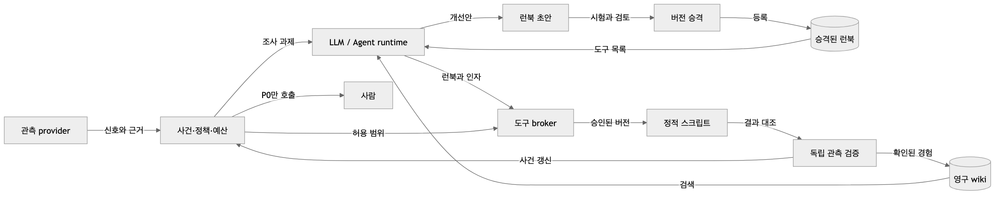

# 범용 SRE 에이전트 엔진 설계

상태: **첫 로컬 slice 구현·검증 / 범용 확장 설계**. 기준일: 2026-10-21. 설계 기준 ref: 공개 `ea0573da36f1bb86945cb12e26f195dc92e9806b`. 독자: 제품·엔진·provider 구현자. 현재 구현의 정본은 연결된 코드·계약 테스트이며 목표 계약과 구분한다.

**제품 목표는 여러 관측 도구와 모델·agent runtime을 조합해 P1/P2를 자율 처리하고, P0에서만 사람을 호출하는 엔진이다.** 심각도, 실행 허용, 알림은 독립된 계약이다. 현재의 로컬 receipt 뷰어는 입력·표현 adapter 중 하나다.

## 1. 현재와 목표

| 구분      | 현재 확인                                                                                                 | 확장 목표                                      |
| --------- | --------------------------------------------------------------------------------------------------------- | ---------------------------------------------- |
| 화면      | 합성 UI/SDS·receipt reader·읽기 전용 로컬 engine projection                                               | 실제 설치의 지속 관측·제어 권한 분리           |
| 관측      | 합성 Observation 입력과 bounded 로컬 HTTP probe ([계약](../scripts/core-probe.test.mjs))                  | 외부 metrics/logs/events provider              |
| 조사      | fixture 및 Responses 단일 tool 제안 adapter, localhost stub 검증 ([계약](../scripts/core-model.test.mjs)) | 실제 모델 연결·agent CLI·다단계 tool 결과 대화 |
| 처리      | 실제 로컬 정적 script·독립 probe·journal·wiki·P0 로컬 outbox ([CLI 계약](../scripts/core-cli.test.mjs))   | 외부 운영 runbook·전송 채널                    |
| 실행 권한 | 등록 version/hash·args·effect/target·deadline 검사 ([broker](../scripts/core-broker.test.mjs))            | 설치별 검토·승격 시스템·외부 runtime 제한 집행 |

이 문서는 엔진 목표 계약과 구현된 첫 slice의 경계를 함께 기록한다. [기존 PRD](PRD.md)의 합성 화면 단계·수동 실행 제안은 구현 이력이며, 아래의 범용 엔진 정책을 고정하지 않는다. 화면 표현은 [DESIGN.md](../DESIGN.md)와 기존 SDS를 재사용한다. 특정 회사의 환경·복구 설정·서비스 명칭·운영 수치는 제품 정책에 포함하지 않는다.

**사용자 확정:** P1/P2는 조사와 사전에 허용된 복구 실행까지 사람 호출 없이 처리한다. P0는 사람을 호출하면서 조사를 계속한다. 허용 런북이 없거나 예산이 끝나면 근거·중단 이유를 남기며 임의 실행이나 P0 승격으로 우회하지 않는다. 실행 가능한 런북과 그 개선안의 승격은 서로 다른 권한이다.



위 그림은 목표 구조다. 현재 검증 범위는 로컬 worker·합성 조사기·HTTP stub·단일 owner journal이며 실제 운영/LLM/MCP 연결을 뜻하지 않는다.

## 2. 엔진이 책임지는 흐름

1. Observation provider가 제한된 조회 결과를 원래 시각·범위·출처와 함께 반환한다. 원천 이벤트 중복과 조회 결과의 의미 변화를 구분한다.
2. 엔진은 입력을 검증하고 사건에 연결한다. 새 영향·악화·지속 임계 도달·회복 후보인지 판정해 다음 조사 시점을 영속화한다.
3. 엔진은 사건/설치 단위 예산과 시도 슬롯을 예약한 뒤 model investigator 또는 agent runtime에 제한된 과제를 보낸다.
4. investigator는 영구 wiki·runbook registry를 검색해 등록 버전과 typed 인자를 제안한다. 엔진/broker는 스키마·근거·버전 hash와 **별도의 실행 정책**을 검사한다.
5. 허용된 정적 script만 executor를 거친다. 적용 결과와 회복은 다르며 새 관측으로 회복을 독립 확인한다. 결과·실패 학습은 wiki 갱신의 근거가 된다.
6. 모든 사건은 상태·감사에 반영한다. P0만 알림 outbox에 기록하며 중복 묶음·ACK·회복 업데이트를 관리한다.

위 순서는 제안된 제어 흐름이다. P0의 검증된 긴급 영향 신호는 모델 응답이나 모델 예산을 기다리지 않고 6번 알림 gate로 갈 수 있다. 조사 작업의 병렬성·성능은 아직 보장하지 않는다.

## 3. Provider 경계와 인증

| 종류          | 소유 책임과 capabilities                                                                       | 인증·금지 경계                                                                         |
| ------------- | ---------------------------------------------------------------------------------------------- | -------------------------------------------------------------------------------------- |
| Observation   | bounded query, events/metrics/logs/probe, cursor, completeness, 원래 observedAt·TTL, 조회 실패 | 설치가 준 읽기 권한만 사용. 빈 결과를 정상으로 해석하거나 운영 쓰기를 수행하지 않음    |
| Model         | structured inference, 입력 상한, cancellation, usage/비용 보고                                 | 공식 API key 또는 해당 API가 공식 지원하는 인증. 임의 agent 실행·운영 권한을 갖지 않음 |
| Agent runtime | 제한된 과제·도구·작업 디렉터리·시간 상한, 세션 재개 가능 여부, 사용량                          | 공식 CLI/SDK가 지원하는 인증·실행 경로만. runtime 자체의 도구 권한을 core 정책과 대조  |
| Action        | 등록된 runbook의 사전조건, 적용, idempotency/reconcile, 결과 receipt                           | 조사 도구와 별도 자격증명·범위. 범용 shell 명령을 모델 출력으로 직접 실행하지 않음     |
| Notification  | P0 episode별 page/update/ACK/readback, delivery dedup 가능 여부                                | 채널별 전송 권한. 알림 성공은 행동 승인이나 회복이 아님                                |

provider는 `capabilities`를 선언하고 contract test로 검증한다. 선언만으로 권한이 생기지 않는다. 도구·파일·네트워크 제한을 집행할 수 없는 runtime은 그 제한이 필요한 자율 실행 구성에 연결하지 않는다. 관측·로그·외부 문서는 신뢰하지 않는 데이터이며 그 안의 지시를 도구 권한으로 승격하지 않는다.

| 후보 계열                 | 목표 역할     | 현재 지원 상태와 확인할 인증                                                                            |
| ------------------------- | ------------- | ------------------------------------------------------------------------------------------------------- |
| OpenAI Responses API      | Model         | 단일 Responses profile·localhost stub 검증. 실제 모델·다른 vendor·Chat Completions 호환은 미검증        |
| Anthropic API             | Model         | 미구현. 공식 API 인증과 해당 모델의 기능을 구현 전에 확인                                               |
| Codex / 공식 구독 CLI     | Agent runtime | 미구현. 공식 지원 실행·로그인·비대화형 동작·도구 제한을 확인한 조합만 지원                              |
| OpenCode                  | Agent runtime | 미구현. 실행 인터페이스와 선택된 하위 모델 provider의 인증을 각각 확인                                  |
| 공식 구독 기반 agent 환경 | Agent runtime | 구독이 범용 API key를 대체한다고 가정하지 않음. 다른 프로그램에서 호출 가능한 공식 경로가 없으면 미지원 |
| Jev                       | 후보          | 지칭 제품·공식 연동 계약 확인 필요. 현재 지원 또는 호환을 주장하지 않음                                 |

비밀은 실행 호스트의 credential resolver가 소유하고 계약에는 `credentialRef`만 전달한다. UI에는 연결 상태·지원 기능·실패 이유만 노출한다. 개인 cookie·token 저장소 추출, 구독 token의 API proxy 전용, 비공식 로그인 우회는 지원 경로가 아니다. 외부 SDK·모델 선정과 공식 문서 검증은 해당 adapter 구현 단계에서 수행한다.

## 4. 코어 도메인과 typed 계약

다음은 **확장 목표의 TypeScript 계약 예시**다. 현재 로컬 schema는 [core/contracts.ts](../core/contracts.ts), 정책은 [policy.ts](../core/policy.ts)가 정본이며 아래 필드 전체를 이미 지원하는 것은 아니다. ID·기능명은 설치가 등록한 값이다. 모든 외부 payload는 runtime validation, 크기/개수 상한, 버전 검사를 거친다.

```ts
type Severity = "P0" | "P1" | "P2" | "unknown";
type EvidenceState = "complete" | "partial" | "missing" | "stale" | "failed";
type AuthKind = "api_key" | "official_cli_session" | "workload_identity" | "none";

interface Observation {
  schemaVersion: 1;
  installationId: string;
  providerId: string;
  sourceEventId: string;
  sourceRevision: string;
  resourceKey: string;
  signalKind: string;
  sourceSeverity?: string;
  observedAt: string;
  expiresAt: string;
  window: { start: string; end: string };
  state: EvidenceState;
  semanticDigest: string;
  evidenceRefs: string[];
}

interface ProviderDescriptor {
  id: string;
  kind: "observation" | "model" | "agent_runtime" | "action" | "notification";
  auth: { kind: AuthKind; credentialRef?: string };
  capabilities: string[];
}

interface RunContext {
  runId: string;
  incidentId: string;
  incidentRevision: number;
  policyRevision: string;
  evidenceRefs: string[];
  budgetReservationId: string;
  deadlineAt: string;
  allowedReadTools: string[];
  // 실행 권한은 포함하지 않는다. 행동 제안은 별도 gate로 보낸다.
}

interface InvestigationResult {
  runId: string;
  basedOnRevision: number;
  findings: { claim: string; evidenceRefs: string[]; uncertainty: string[] }[];
  proposedSeverity: Severity;
  proposedActions: {
    runbookRef: { id: string; version: string; digest: string };
    parameters: Record<string, unknown>;
  }[];
  usage: { inputTokens?: number; outputTokens?: number; costMicros?: number };
  outcome: "completed" | "failed" | "cancelled" | "timed_out";
}

interface ActionGrant {
  grantId: string;
  policyRevision: string;
  incidentId: string;
  runbookId: string;
  runbookVersion: string;
  runbookDigest: string;
  targetScopeDigest: string;
  expiresAt: string;
  preconditionEvidenceRefs: string[];
  idempotencyKey: string;
}

interface ObservationProvider {
  collect(
    request: { resourceKey: string; cursor?: string; deadlineAt: string },
    signal: AbortSignal,
  ): Promise<{ observations: Observation[]; nextCursor?: string }>;
}
interface Investigator {
  investigate(context: RunContext, signal: AbortSignal): Promise<InvestigationResult>;
}
```

`semanticDigest`는 조회 시각·모델 문장 차이를 제외한 정규화 신호의 의미를 묶는다. 정확한 정규화 규칙은 signal schema 버전에 속한다. `sourceEventId/sourceRevision` 입력 중복, 사건 correlation, 의미 변화는 서로 다른 키다. digest는 내용 연결용이지 원천 진위의 서명이 아니다.

Observation은 범용 envelope다. 기존 [receipt reader](../src/providers/receipt.ts)의 ClickHouse·배포 등 enum은 한 adapter의 표시 계약으로 유지한다. 코어에 그 claim 목록을 복사하지 않는다. 신규 signal schema는 설치의 registry에 등록하며 임의 필드·ID를 UI에 그대로 노출하지 않는다. 로그 원문과 모델의 내부 추론은 기본 감사 저장 대상이 아니다.

## 5. 지속 상태와 조사 제어

아래 표는 목표 소유 계약이며 현재 전이와 필드는 [엔진](../core/engine.ts)·[계약](../core/contracts.ts) 및 [상태 테스트](../scripts/core-engine.test.mjs)에 한정된다. 엔진이 사건 정본을 소유한다. provider 내부 세션은 조사 실행의 참조일 뿐 사건의 정본이 아니다.

| 엔진 상태 | 저장할 의미                                                                     | 전이 guard                                                                        |
| --------- | ------------------------------------------------------------------------------- | --------------------------------------------------------------------------------- |
| 사건      | resource/correlation, episode, severity와 근거, evidence state, revision        | 영향 근거 변화로 severity 재평가. 모델 등급은 제안                                |
| 조사      | queued/running/waiting_observation/budget_paused/blocked, dueAt, run 이력       | 같은 revision 중복 실행 금지. 새 의미 변화 또는 정책상 지속 임계 도달과 예산 필요 |
| 회복      | unverified/checking/verified/failed, 검증 근거                                  | 실행 뒤 새 관측·목표 범위·정책상 관측 기간을 충족해야 verified                    |
| 행동      | proposed/authorized/executing/applied/outcome_unknown/verified/failed/rejected  | grant 재검증 후 적용. applied는 회복이 아님                                       |
| 알림      | episode별 dedup key, outbox, 외부 메시지 참조, ACK와 만료, 마지막 알림 revision | P0 gate 및 의미 변화·재호출 정책 충족                                             |
| 예산·감사 | 기간별 사용/예약·실행 시도·deadline·policy revision·행동/전송 의도·결과         | 실행 전에 원자적으로 예약·기록                                                    |

관측 없음·오류·만료는 `missing/failed/stale`로 남긴다. 상태 판정에 필요한 근거를 잃으면 unknown이지 회복이 아니다. 기존 P0에 새 데이터가 없다는 이유로 P0를 해제하지 않는다. 장기 지속은 새 원천 이벤트가 없어도 `dueAt`을 통해 재평가할 수 있으나 같은 poll마다 재조사하지 않는다. 회복 후보와 악화는 각각 새로운 근거 revision을 만든다. 늦게 끝난 모델 결과는 `basedOnRevision`이 오래되면 최신 사건을 덮지 않고 이력에 보존한다.

**현재 예산은 기간별 호출 횟수 예약과 사건별 기간 시도 상한이다.** `maxAttemptsPerIncidentPerPeriod`는 새 기간+dueAt에서 재개하며 lifetime `attempts`는 감사용이다. 실제 token usage는 telemetry로만 보존하고 금액/token 예산은 집행하지 않는다. 미응답 호출의 예약을 환불하지 않는 경계를 [재시작](../scripts/core-crash.test.mjs)·[모델 오류](../scripts/core-engine.test.mjs)에서 검증한다. 확장 목표는 설치·사건·기간별 비용, token/tool call, wall time, 시도 수를 함께 제한하는 것이다. 정확한 상한과 기간은 설치 정책이며 아직 운영 기본 수치를 정하지 않았다. 예약은 호출 전에 차감하고 실제 사용량과 정산한다. 취소·timeout·프로세스 중단의 미확정 비용을 즉시 환불하지 않는다. 사용량을 알 수 없는 provider는 비용이 확인됐다고 기록하지 않으며, 강제할 수 있는 token/시간 제한과 해당 설치의 정책을 만족할 때만 실행한다. child agent도 같은 예약을 공유하며 별도 무제한 예산을 만들지 않는다.

## 6. 심각도·권한·알림의 독립성

**심각도:** 원천의 `sourceSeverity`와 사람 호출 등급을 분리한다. 운영자가 등록한 신뢰 원천·영향 조건·심각도 매핑으로 P0를 확정하며 특정 설치의 고객 영향 판정식을 전역 고정하지 않는다. 예산 소진, 권한 부재, 모델 실패 자체는 P0 생성 사유가 아니다. 중요 관측의 장기 공백이 설치의 긴급 영향 조건에 해당한다면 그 근거·정책으로 판단한다. 확정 P0의 page는 모델 응답·모델 예산을 기다리지 않는다. LLM만의 권고로 확정 P0를 낮추거나 page를 취소하지 못한다.

**권한:** severity를 action allowlist로 쓰지 않는다. P2라도 파괴적 제안은 금지될 수 있고, P0에도 사전 허용된 안전 runbook이 있을 수 있다. grant는 등록 runbook, 대상 범위, 유효기간, 근거, 동시 실행 제한, 검증 계획을 포함한다. 모델이 grant를 발급하거나 범위를 넓히지 못한다. 미허용 action은 `blocked/rejected`와 이유를 UI·감사에 남기며 P0 page로 자동 전환하지 않는다. P1/P2는 등록·사전 허용된 runbook을 자율 실행할 수 있다. 새 effect·권한 확대·allowlist 밖 대상은 운영자 승인 없이는 실행할 수 없다.

도구·행동 권한의 owner는 엔진 또는 그 tool broker다. 외부 agent runtime의 자체 shell/tools로 gate를 우회할 수 없도록 허용 도구만 broker에 연결하고 운영 action credential은 runtime에 주지 않는다. runtime의 파일·네트워크·환경 권한을 이 경계로 제한할 수 없다면 해당 자율 실행 구성을 지원하지 않는다. P0라고 에이전트 전체를 정지하거나 모든 도구를 개방하지 않는다.

**알림:** P1/P2는 대외 알림을 기본 억제하고 조사·시도·중단 상태를 UI와 감사에 남긴다. P0 최초 판정은 episode당 한 page 의도를 기록한다. 같은 episode·같은 의미 revision의 반복 입력은 새 page가 아니다. ACK는 수신 확인이며 사건 종료·실행 승인·회복이 아니다. ACK 이후에도 조사와 독립 회복 검증은 지속한다. 악화·영향 범위 변화·ACK 만료 뒤 미해결 상태의 재호출 조건과 간격은 설치 정책으로 명시한다. 회복 검증 뒤에는 기존 episode의 회복 업데이트를 보내고 다음 새 장애는 새 episode로 연다.

P0는 사람을 호출하면서도 에이전트가 예산·권한 범위에서 조사와 근거 갱신을 계속한다. P1/P2의 처리 완료 역시 모델의 `completed` 선언으로 사건을 닫지 않는다. 조사가 끝난 것과 문제가 해결된 것을 구분하고, action 유무와 관계없이 별도 fresh 관측이 설치의 회복 기준을 충족해야 사건을 종료한다.

## 7. 영구 wiki와 versioned runbook

**합의 목표:** 경험을 Git/Markdown에 영구 축적하고 LLM이 검색·선택해 호출할 수 있게 한다. 매 사건마다 임의 shell을 새로 만드는 흐름을 실행 경로로 사용하지 않는다.

`지식 검색 → 등록 런북 선택 → typed args → broker/policy → 정적 script → 독립 관측 → 지식 갱신`이 기본 경로다. 호출 transport와 지식·실행 정본은 분리한다.

| 구성                       | 정본·역할                                                                                         | 권한이 생기지 않는 것                                       |
| -------------------------- | ------------------------------------------------------------------------------------------------- | ----------------------------------------------------------- |
| 설치의 Git/Markdown wiki   | 사건 요약, 증거 참조, 패턴, 선택·기각 대안, 실패 학습, 회복 검증 결과. Git revision으로 변경 추적 | wiki의 문장·코드 블록은 실행 허가가 아님                    |
| Versioned runbook registry | 검토·승격된 manifest, 인자 JSON Schema, 정적 scripts, tests, 문서, bundle digest                  | 검색에 걸리거나 새 파일이 생겨도 실행 가능 버전이 되지 않음 |
| MCP export                 | 등록 도구의 발견·typed 호출을 runtime에 연결하는 선택적 인터페이스                                | MCP 자체는 엔진 예산·권한·실행 격리를 보장하지 않음         |
| AgentSkills export         | `SKILL.md`와 scripts 등으로 agent에 절차·사용법을 제공하는 선택적 배포 형태                       | skill을 로드했다고 runbook 승격·실행 권한이 생기지 않음     |
| LSP                        | 편집기 언어 기능의 별도 프로토콜                                                                  | 여기서 필요한 영구 지식·런북 실행 정본이 아님               |

MCP/AgentSkills는 서로 대체하는 데이터베이스가 아니다. **canonical runbook 하나에서** 선택적 tool schema·`SKILL.md`·사용 예시를 파생한다. scripts의 두 번째 수동 사본을 만들지 않고 같은 version/digest의 bundle을 참조한다. adapter/runtime마다 MCP·Skills·공식 CLI 지원 여부가 다르므로 지원 capability로 노출한다. 첫 구현이 모든 runtime에서 같은 export를 쓸 수 있다고 가정하지 않는다.

공식 [MCP Tools 명세](https://modelcontextprotocol.io/specification/2026-07-28/server/tools.md)는 `tools/list`, JSON Schema `inputSchema`, `tools/call`을 정의한다. [공식 SDK 안내](https://modelcontextprotocol.io/docs/2026-07-28/sdk)와 [서버 가이드](https://modelcontextprotocol.io/docs/develop/build-server)는 이 프로토콜을 구현하는 수단이다. 이 사실이 runbook 승격·설치 예산·효과 멱등을 제공한다는 뜻은 아니다. 명세는 사람이 호출을 거부할 수 있는 UI를 권고하며 신뢰되지 않은 annotation에 의존하지 않도록 경고한다. 각 client의 공식 자동화·사전 허용 모드를 확인하고, 필요한 승인을 비공식 우회로 제거하지 않는다.

공식 [Agent Skills 명세](https://agentskills.io/specification)는 `SKILL.md`의 `name`·`description`과 선택적인 `scripts/`·`references/`·`assets/` 구조를 정의한다. `allowed-tools`는 실험 필드이고 agent별 지원이 다르므로 권한 집행의 근거로 삼지 않는다. 본 제품의 Skills export는 절차·등록 버전·broker 호출을 안내한다. 실행 payload는 canonical bundle에서만 제공하며, 문서 속 script를 직접 실행해 broker를 건너뛰지 않는다. Git registry·hash·promotion은 위 표의 **제품 설계**이고 MCP/Skills가 정한 기능으로 주장하지 않는다.

현재 정적 예제 구조는 `runbooks/<id>/manifest.json`, `args.schema.json`, `scripts/`, `tests/`, `README.md`이며, `wiki/incidents/`·`wiki/patterns/`는 설치의 지식 저장소다. 검색 index는 Git 내용에서 재생성할 수 있는 파생물이고 승인 정본이 아니다. 설치 wiki가 공개 저장소여야 하는 것은 아니며 고객 데이터·secret·원문 로그를 OSS 저장소로 자동 게시하지 않는다.

아래는 **설명용 합성 manifest**다. 실제 파일·등록 기능은 아직 없다.

```json
{
  "schemaVersion": 1,
  "id": "recover-demo-worker",
  "version": "1.0.0",
  "argsSchema": "args.schema.json",
  "entrypoint": "scripts/recover.mjs",
  "runtime": "node",
  "effects": ["demo.worker.restart"],
  "requiredScope": "demo-worker",
  "preconditionProbe": "worker-degraded",
  "verificationProbe": "worker-ready",
  "reconcileProbe": "worker-action-result",
  "timeoutMs": 10000,
  "maxConcurrent": 1
}
```

현재 registry는 정적 runbook 디렉터리의 manifest·JSON Schema·scripts/helper·tests·문서를 포함한 결정론적 bundle digest를 고정한다. 첫 예제는 외부 의존성이 없으며 설치 allowlist가 그 version/hash를 승인한다. 자동 promotion 서비스와 별도 승격 Git revision receipt는 확장 목표다. CLI 실행 receipt에는 전체 source revision을 기록한다. 설치 allowlist는 `runbookId+version+digest+effect+target scope`를 허용한다. broker는 typed args를 검증하고 대상 scope·최신 사전조건·예산·실행 동시성·grant 만료를 검사한다. LLM이 제안한 임의 script 경로·환경변수·명령 문자열은 실행 입력이 아니다. 실행 직전 digest를 다시 대조해 문서/인덱스의 오래된 참조와 파일 교체를 차단한다.

현재는 사건/실패 요약의 자동 기록·exact failureClass 검색·텍스트 draft 분리·metadata 파생까지 구현했다. 별도 의미 검색·자동 코드 수정·운영 승격 서비스는 미구현이다. Git wiki는 marker가 있는 engine-owned 전용 repo만 운용하며 변경한 지식 파일만 commit한다([계약](../scripts/core-wiki.test.mjs)).

**확장 개선 경로:** 사건의 근거로 wiki 갱신·runbook draft 작성 → schema/정적 검사·테스트·sandbox 검증 → 지정 reviewer 검토 → 권한 있는 registry owner의 promotion → 버전 hash/allowlist 갱신. 새 effect·대상 확대·권한 확대는 운영자 승인 대상이다. 기존 범위 안의 개선도 설치가 정한 검토·승격 절차를 거친 버전만 실행한다. 모델의 자신감이나 같은 모델의 셀프 리뷰만으로 실행 권한을 넓히지 않는다.

**실행과 개선은 별도 권한:** 이미 승인된 P1/P2 runbook을 실행하는 agent가 registry를 수정·승격할 권한까지 갖는 것은 아니다. 학습 결과가 실패한 런북을 자동 교체해 즉시 실행하지 않는다. 이전 버전·기각 이유·실패 테스트를 보존하고, 재발 시 어떤 근거와 버전으로 행동했는지 추적한다. 회복을 검증하지 못한 경험은 성공 패턴으로 승격하지 않는다.

## 8. 감사와 재시작 시 중복 효과

입력 dedup, 사건 revision, 조사 예약, 예산 예약, action/notification 의도는 durable transaction으로 기록한다. 첫 구현은 단일 engine owner와 `CoreStore.transaction` 경계를 둔다. 저장소 adapter·동시 실행 방식은 아래 slice에 한정한다.

- 외부 효과 전에 idempotency key와 의도를 저장하고 결과 receipt를 연결한다. 재시작 뒤 미완료 의도는 reconcile한다.
- provider가 idempotency/readback을 제공하지 않고 응답을 잃었다면 `outcome_unknown`으로 둔다. 무조건 재시도해 중복 복구·중복 page를 만들지 않는다.
- 네트워크 전송 전체의 exactly-once를 주장하지 않는다. 알림도 provider의 dedup/readback 수준을 노출하고 전달 미확정을 보존한다.
- 감사에는 입력/정책/근거 revision, 권한 판정, 예산 변화, 적용·검증 결과를 남긴다. 보존·마스킹은 설치 정책이며 credential과 원문 민감정보를 모델 prompt·UI·감사에 자동 복제하지 않는다.

## 9. 대표 시나리오

다음은 모두 **설명용 합성 예시**다. 등급과 임계값은 특정 설치의 예시이며 제품의 하드코딩 기준이 아니다.

| 사례              | 입력 → 엔진 처리                                                              | 행동·관측 출력                                                                                               | 완료 검증                                                                                 |
| ----------------- | ----------------------------------------------------------------------------- | ------------------------------------------------------------------------------------------------------------ | ----------------------------------------------------------------------------------------- |
| P2 지연 증가      | fresh metric과 로그가 제한된 지연을 나타냄 → 중복 묶음·예산 예약·조사         | 등록 런북의 사전 허용 범위에서 자율 처리. runbook 미허용이면 진단·다음 확인 조건 보존. 대외 page 없음        | 같은 poll 반복 시 호출/전송 증가 없음, 근거 변화나 dueAt에서만 재조사                     |
| P1 worker 이상    | 반복 오류·영향 범위 확인 → 원인 조사·허용 runbook 제안                        | 실행 허용이면 단일 target의 사전조건을 확인해 적용. 비허용이면 blocked. 적용 성공만으로 회복 판정하지 않음   | 새 probe로 회복 확인, 누락 probe에서는 unverified. 예산 중단도 P0/page로 바뀌지 않음      |
| P0 핵심 기능 중단 | authoritative impact rule이 긴급 중단 확인 → 모델 대기 없이 episode page 의도 | 같은 사건은 묶고 ACK 기록. 조사·허용 행동·새 회복 검증을 계속하며 의미 변화와 회복을 같은 episode에 업데이트 | 중복 입력·재시작에 page 의도1개, ACK와 recovery 분리, 결과 미확정 전송의 blind retry 없음 |

합성 실행 정책 예시는 아래처럼 심각도와 분리한다. **제품 기본 설정이 아니다.**

```json
{
  "exampleKind": "synthetic",
  "actionPolicy": {
    "runbookId": "restart-single-worker",
    "targetSelector": "demo-worker-group",
    "maxConcurrent": 1,
    "requiresFreshPreconditions": true,
    "verificationProbe": "worker-ready"
  },
  "notificationPolicy": {
    "pageSeverities": ["P0"],
    "groupBy": ["resourceKey", "failureClass", "episode"]
  }
}
```

## 10. 첫 작동 vertical slice

**현재 구현:** 로컬 Node 엔진에서 합성 입력을 실제 지속 상태·예산·재조사·알림 outbox까지 처리한다. 기존 화면은 그 projection을 읽는다. 다른 운영 환경이나 특정 데이터베이스가 있어야 작동하는 구조로 시작하지 않는다.

1. CLI가 버전·freshness가 있는 합성 Observation을 `Engine.ingest`에 전달한다. 실제 로컬 HTTP probe는 script와 독립적으로 파일 상태/operation을 읽는다. 외부 json-events collector와 receipt→core 자동 변환은 아직 연결하지 않았다.
2. investigator 계약에 deterministic fixture adapter와 `OpenAIResponsesInvestigator`를 구현했다. fixture는 재현 가능한 테스트용이며 실제 모델 실행으로 표시하지 않는다. Responses adapter는 공식 wire로 만든 로컬 stub→core→broker→wiki와 오류/크기/abort/redirect/args를 검증했다. API key·실모델 live 호출은 0이며 실제 인증 연결은 별도 smoke가 필요하다. 응답 도구 제안 한 번만 처리하고 후속 function_call_output 대화는 아직 지원하지 않는다.
3. 단일 프로세스 `CoreStore`는 우선 로컬 append journal로 구현한다. 한 transaction record 안에 사건·예약·outbox 변경을 기록하고 flush 성공 뒤 외부 효과를 시작한다. transaction ID 재생은 멱등이어야 하며 시작 시 단일 owner 잠금을 획득한다. 손상/불완전 tail은 복구 전 효과를 멈춘다. 분산 owner·다중 호스트 원자성은 이 slice 범위 밖이다.
4. scheduler는 persisted `dueAt`·fake clock·시도/기간 예산을 사용한다. 재시작 후 같은 입력은 새 조사나 비용 예약을 만들지 않는다.
5. canonical runbook 1개를 manifest+JSON Schema+정적 Node script+tests+문서로 등록한다. 소유한 로컬 테스트 workspace의 합성 worker 상태를 바꾸는 사전 허용 script를 실제로 실행하고 별도 HTTP probe로 회복을 검증한다. unknown/거부/실패는 테스트 probe와 중단 fixture로 주입한다. 외부 운영 리소스의 복구는 이 slice 범위 밖이다.
6. Git/Markdown wiki에 사건 요약·근거 참조·런북 버전·실패 학습을 기록하고 다음 같은 사례에서 검색해 재사용한다. 새 런북 수정안은 draft로만 생성하며 테스트/검토/승격 전 runtime registry에 노출하지 않는다. MCP/AgentSkills는 우선 metadata와 tool contract를 생성해 정본 일치를 검증한다.
7. notification은 로컬 durable outbox 상태 전이로 P0 page/ACK/update/recovery를 검증한다. 첫 외부 채널 adapter는 그다음 범위다. UI에 실제 engine run과 합성 입력/fixture investigator 여부를 명시한다.

구현 모듈은 `core/`(엔진·broker·정책·registry·tool metadata), `providers/`(fixture·Responses·로컬 HTTP probe·Git wiki), `storage/`(journal)다. 화면 projection은 `Engine.projection()`·`server/engine-provider.mjs`·`src/EngineApp.tsx`가 제공한다. 스케줄러는 호출자가 구동하는 `tick()` API이며 상시 daemon은 미연결이다. 현재 registry는 안전한 상대 `.mjs` entrypoint와 helper·schema·문서·tests를 포함한 전체 bundle을 hash하고 symlink를 거부한다. 인자 JSON Schema는 object+string const subset만 지원한다. script는 신뢰된 운영자 승인 코드이며 비신뢰 코드를 격리하는 sandbox를 제공하지 않는다. runtime provider의 공식 CLI integration과 두 번째 실제 모델·관측 시스템으로 교체 가능성을 증명하는 작업은 뒤따르는 인수다. 첫 slice 성공을 모든 provider 지원으로 확대하지 않는다.

### 10.1 현재 인수와 재현

- [x] [엔진 계약](../scripts/core-engine.test.mjs): 중복·동일 poll·의미 변화·지속 dueAt, 같은 기간 재시작/다음 기간 재개, P0/ACK/예산 분리, 과거 관측 거부, stale 모델, 실제 실패 학습과 wiki 런북 선택.
- [x] [broker](../scripts/core-broker.test.mjs)·[probe](../scripts/core-probe.test.mjs): typed args/권한/hash, 동시 의도1개, persisted deadline, 무응답 시간 제한, unknown→다음 probe→verified와 script1회.
- [x] [SIGKILL](../scripts/core-crash.test.mjs)·[journal](../scripts/core-journal.test.mjs): 의도 직후·효과 직후·모델 대기 중 강제 종료와 재시작, 미확정 효과/예약 보존, 단일 owner·flush·손상 tail 거부.
- [x] [wiki](../scripts/core-wiki.test.mjs)·[registry](../scripts/core-registry.test.mjs): 영구 Git 기록·재검색, 실패/draft와 실행 분리, 전용 repo·파일 한정 commit, helper 포함 hash 거부.
- [x] [metadata](../scripts/core-tools.test.mjs): 같은 정본의 MCP tool schema/AgentSkills와 broker 실제 호출. 실제 MCP transport/client 연결 검증은 아님.
- [x] [모델](../scripts/core-model.test.mjs): Responses strict tool 제안·재검증·token telemetry와 bounded localhost HTTP stub. 실제 모델·credential·다른 vendor 검증은 아님.
- [x] [CLI](../scripts/core-cli.test.mjs): P1 실제 로컬 복구→wiki→다음 선택, P2 억제, P0 page 의도/ACK/조사 지속, 저장소 밖 projection과 resume 중복 효과0.
- [ ] 외부 provider/모델/운영 runbook·알림 채널, 금액/token 예산, 다중 provider 충돌, 분산 owner·전원 손실, 일반 JSON Schema·의미 검색·자동 승격은 후속 인수다.

`pnpm test:core`로 재현한다. `pnpm engine:demo`는 private temp workspace에 journal/Git wiki/파생 metadata/projection/receipt를 남긴다. `--workspace <이전 경로> --scenario resume`은 새 효과를 만들지 않고 대조한다. `crash-after-execute`는 자체 프로세스를 SIGKILL하며 `resume --recover-stale-lock`은 죽은 owner를 확인한 뒤 명시적으로 잠금을 회수한다. P0 outbox는 전송 의도이고 외부 page는 하지 않는다.

설계 승인, 로컬 slice 인수, 선택한 실제 provider의 인증 연결, 운영 활성화는 별도 단계다. 코드의 한도·worker ID·가짜 시간은 합성 설치 설정이며 운영 기본값으로 권고하지 않는다. 파일 sync는 OS/device에 의존하고 네트워크 파일시스템·전원 손실을 포함한 exactly-once를 보장하지 않는다.

## 11. 남은 결정과 위험

| 결정·위험                                                              | 담당 / 해결 시점                                                                   |
| ---------------------------------------------------------------------- | ---------------------------------------------------------------------------------- |
| P1/P2 조사+사전 허용 복구                                              | 사용자 확정 / 설치별 runbook·대상 allowlist는 활성화 전 검토                       |
| 첫 실제 모델·runtime의 공식 API/CLI·인증·제한·usage 계약               | 구현자+사용자 / 실제 인증 연결·agent CLI 연동 전                                   |
| severity·correlation·지속/재호출·회복 관측 기간의 설치별 policy schema | 운영 설치 정책 인수 전. 합성 수치로 운영 기본값을 만들지 않음                      |
| 단일 owner journal의 crash durability와 보존·크기 관리                 | 저장소 구현자 / crash-injection 인수. 검증 실패 시 storage adapter 재선정          |
| runbook bundle digest·승격 역할·JSON Schema·export 동기화              | 엔진/adapter 구현자 / 운영 런북 확장·승격 서비스 인수 전                           |
| runtime의 우회 도구·네트워크/secret 접근                               | adapter 구현자 / capability 지원 선언 전. 제한 집행 증거가 없으면 해당 구성 미지원 |
| 관측 중복과 실제 의미 변화의 잘못된 병합                               | signal schema 구현자 / provider contract test와 incident fixture                   |
| 비용 보고 지연·알림/action 응답 손실                                   | 엔진+adapter / 미확정 상태와 reconcile 인수                                        |

읽는 순서: [README](../README.md) → 이 문서 → [DESIGN](../DESIGN.md) → 현재 [ReceiptApp](../src/ReceiptApp.tsx)·[receipt adapter](../server/receipt-provider.mjs). 현재 소스는 로컬 엔진·UI·스냅샷 경계의 근거이고, 이 문서는 구현된 로컬 slice와 다음 확장 목표의 정본이다.
